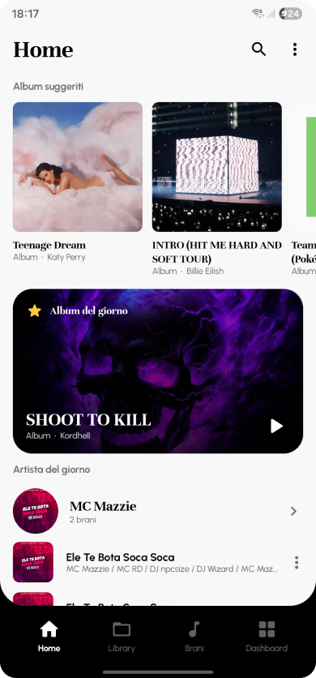
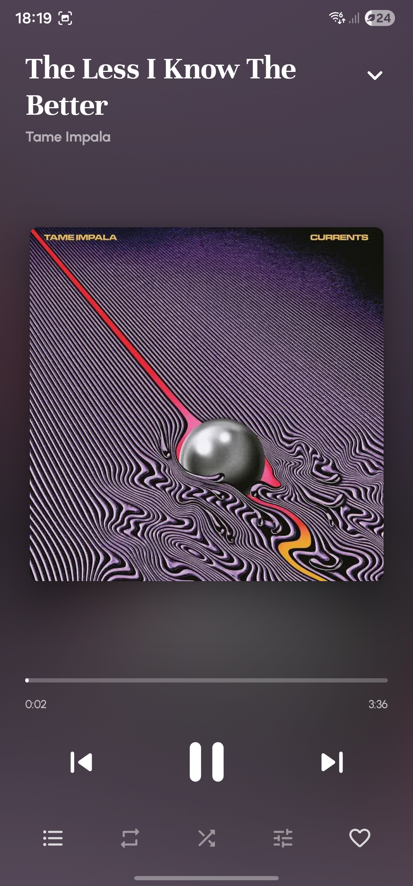
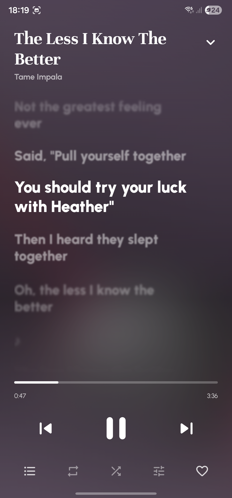
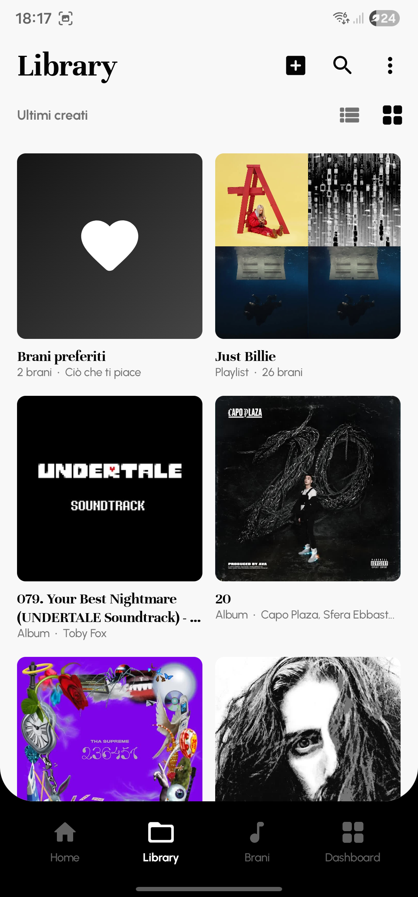
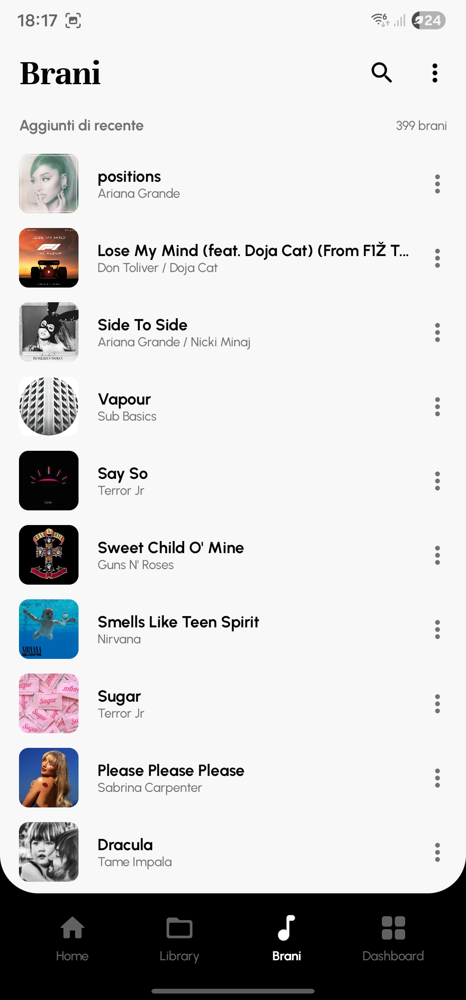
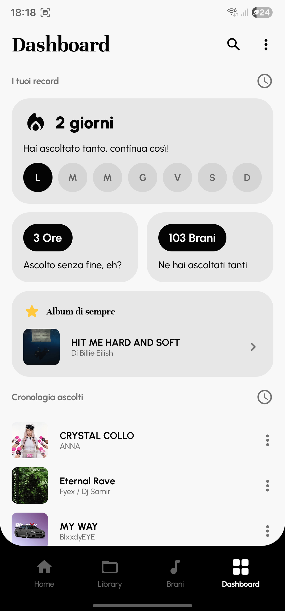

Readme · MD

# 💙 MONOS - LOCAL MUSIC PLAYER

 
Un player musicale per Android, pensato per chi ascolta i **propri brani locali**: niente account, niente abbonamenti, niente tracciamento. Un'interfaccia pulita e minimale, con testi sincronizzati, controlli separati di velocità e pitch e una dashboard con le tue statistiche d'ascolto.
 
> Il progetto è nato come esperimento di design: l'interfaccia segue un file Figma ed è costruita da zero, senza componenti Material 3.

 
## Caratteristiche
 
### 🎧 Ascolto 
- Legge i brani già presenti sul telefono (titolo, artista, album, copertina) tramite MediaStore.
- Riproduzione in background con notifica e controlli dalla schermata di blocco e dalle cuffie.
- **Velocità e pitch indipendenti**: puoi accelerare un brano senza alterarne il tono, o cambiarne il tono senza toccare la velocità.
- Casuale, ripeti brano o tutti, e un cuore per salvare i preferiti.
### ▶️ Il player 

- Schermo intero con **sfondo sfocato** costruito sui colori della copertina (la sfocatura vera richiede Android 12 o successivo; sulle versioni precedenti si usa un gradiente).
- Tre pagine da scorrere con un gesto: **Informazioni**, **Copertina** e **Testi**. La pagina Informazioni compare solo per i brani che appartengono a un album e mostra la posizione del brano ("Traccia 3 di 14"), gli artisti e i dati audio.
- Transizioni animate al cambio brano e al trascinamento del player verso il basso.
- Mini player e barra di navigazione in una fascia scura che prende il colore della copertina in riproduzione.
### 🎶 Testi sincronizzati

- Le righe scorrono a tempo: quella corrente è in evidenza, le altre sfumano e si sfocano. Un tocco su una riga porta il brano a quel punto.
- I testi si scaricano da [LRCLIB](https://lrclib.net), un database gratuito e collaborativo, alla prima apertura di un brano, oppure tutti insieme dalle impostazioni.
- Una volta scaricati restano salvati nell'app. Puoi anche importare a mano un file `.lrc`.
### 📌 Organizzazione
 
- **Home**: album suggeriti, album del giorno, artista del giorno con alcuni brani, brani suggeriti. Le proposte del giorno cambiano ogni giorno e nascono dai metadati dei tuoi brani.
- **Library**: brani preferiti, playlist e album, in griglia o in elenco.
- **Brani**: l'elenco completo, per data di aggiunta o in ordine alfabetico.
- Ricerca su brani, album e artisti.
- Playlist create da te, con scelta dei brani dall'elenco.
### ❇️ Dashboard

Statistiche calcolate **solo sul telefono** 📲, a partire dal giorno in cui installi l'app:
- giorni di ascolto consecutivi, con la settimana in corso;
- ore totali di ascolto;
- numero di brani ascoltati (un brano conta dopo 20 secondi);
- album più ascoltato di sempre;
- cronologia degli ascolti recenti.
## ❗ Privacy
- Nessun account, nessuna pubblicità, nessun servizio di analisi. ✨
- Preferiti, playlist e statistiche restano nella memoria dell'app.
- La connessione a internet serve **solo** per scaricare i testi da LRCLIB.
## Permessi
| Permesso | A cosa serve |
|---|---|
| Lettura dei file audio | Trovare i brani sul telefono |
| Notifiche | Controlli di riproduzione nella notifica |
| Internet | Scaricare i testi da LRCLIB |
 
## Requisiti
- Android 8.0 (API 26) o successivo.
## Come ottenere l'APK
 
## Tecnologie
- **Kotlin** e **Jetpack Compose**, con componenti grafici scritti da zero
- **Media3** (ExoPlayer e MediaSession) per la riproduzione
- **DataStore** per preferenze, preferiti, playlist e statistiche
- **MediaStore** per la libreria locale
## Crediti
- Testi: [LRCLIB](https://lrclib.net)
- Font: [Unna](https://fonts.google.com/specimen/Unna) e [Urbanist](https://fonts.google.com/specimen/Urbanist), distribuiti con licenza SIL Open Font License
- Icone: Material Icons (licenza Apache 2.0)
- Design: file Figma realizzato per questo progetto
I testi appartengono ai rispettivi autori e vanno usati solo per ascolto personale.
 
## Prossimamente 👀 - Monos v-1.05
- Stile "pillola" per il mini player e pagine della barra personalizzabili
- Pagina delle impostazioni completa (stile dell'app, testi, navigazione, dati)
- Cartelle unite: trascina un album su un altro per raggrupparli
- Coda di riproduzione e controllo unico per velocità e pitch
- APK firmato per l'installazione senza avvisi

## Licenza
Da definire.
